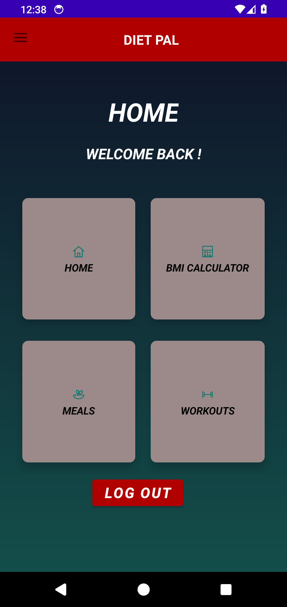
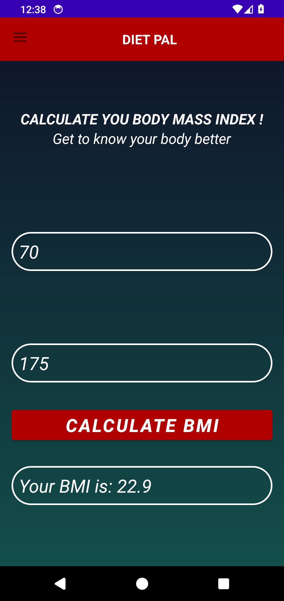
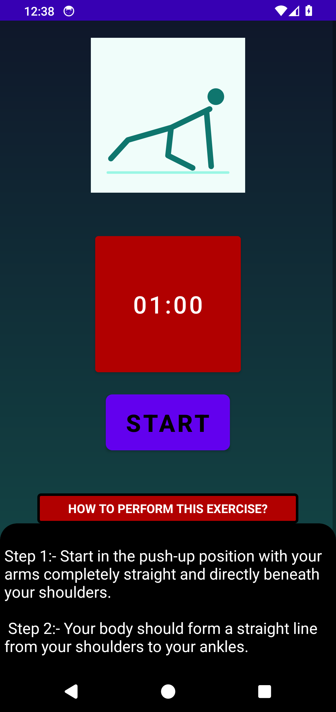

# DietPal

A Java Android coursework app combining local registration and login, a BMI calculator, timed workout screens and optional Spoonacular recipe browsing. Originally developed during my bachelor's studies at **Majan University College** for **Mobile Application Development, 2023–24**.

**My work:** the original Android application implementation. This repository is a portfolio edition prepared in October 2026; the original submission is preserved privately. The fixes, replacement artwork and added tests are recorded in [Portfolio changes](docs/PORTFOLIO_CHANGES.md).

## Screens

Screenshots show this edition running on an Android 14 emulator with synthetic demonstration inputs.

  

## What works

| Area | Behaviour |
| --- | --- |
| Local accounts | Registration, duplicate-username checking and login using an on-device SQLite database. Passwords use individually salted PBKDF2-HMAC-SHA256 hashes. |
| BMI calculation | Kilograms/centimetres input, decimal calculation and rejection of invalid, zero, negative or non-finite values. |
| Workouts | Fifteen exercise screens, original static vector illustrations, countdown start/pause and next-exercise navigation. Timers stop when the workout screen is left. |
| Recipes | Retrofit client for random recipes, recipe details, instructions and similar recipes. A developer-supplied Spoonacular key is required. The unconfigured state displays a message and closes loading indicators. |
| Navigation | Home cards, drawer navigation and logout that clears the previous activity stack. |

The app demonstrates Android activities/fragments, XML layouts, SQLite, asynchronous work, HTTP/API integration and automated testing. It has no hosted account service, nutrition-tracking history or personalised diet model. Unfinished settings/profile functionality is not presented as a supported feature.

## Build and run

Use **JDK 17**, Android SDK **platform 34**, SDK **build-tools 33.0.1** and Android **8.0 / API 26 or newer**. The repository includes the Gradle 8.0 wrapper with a pinned distribution checksum and Android Gradle Plugin 8.1.2.

1. Open the project in Android Studio, or configure the SDK in an ignored `local.properties` file using `sdk.dir=/absolute/path/to/Android/Sdk`.
2. Optionally copy `secrets.properties.example` to `secrets.properties` and set `spoonacularApiKey` to your own [Spoonacular API key](https://spoonacular.com/food-api). Registration, BMI and workouts run without it. Never commit that file.
3. Build and check the project:

```powershell
.\gradlew.bat assembleDebug lintDebug testDebugUnitTest
```

On macOS/Linux use `./gradlew` instead. The debug APK is generated under `app/build/outputs/apk/debug/`. Install it on an emulator or your development device through Android Studio.

To run the emulator-only UI smoke test, start an Android 14 / API 34 emulator and run:

```powershell
.\gradlew.bat connectedDebugAndroidTest
```

The smoke test creates and removes its own synthetic account. Its configuration assumes an empty recipe key so that it makes no live Spoonacular requests. It deliberately skips physical devices. Use a dedicated development emulator.

## Verification and limits

The APK build passed, **17 host regression tests passed**, and the complete workflow passed on an **AOSP Android 14 / API 34 emulator**. Lint completed with **zero errors and 197 warnings**, mainly retained coursework layout/resource/style items. One narrowly scoped exception covers an unused notification API inside Picasso; DietPal does not post notifications.

See [Validation](docs/VALIDATION.md) for the tested flows and remaining limits. No physical-device test, live recipe API response, API quota check or production-security assessment is claimed. The local account system is an educational demonstration. BMI is an arithmetic feature; this project does not establish clinical or fitness effectiveness.

An API key embedded in a client APK can be extracted. The ignored configuration prevents accidental source-control disclosure; it does not turn a mobile client into a secure secret store. Use your own development key and provider terms.

## Provenance

The original configured key, local SDK paths, IDE caches, build outputs, database files and academic cover details are excluded. Workout GIFs and photos whose reuse permissions were unknown have been replaced with original vector resources. Runtime recipe data/images are provided by the configured external service and are not included here.

[Portfolio changes](docs/PORTFOLIO_CHANGES.md) distinguishes the historical app from this edition. [Third-party notices](docs/THIRD_PARTY_NOTICES.md) identifies the build wrapper and dependencies. No repository-wide licence has been selected; upstream components retain their own terms.
