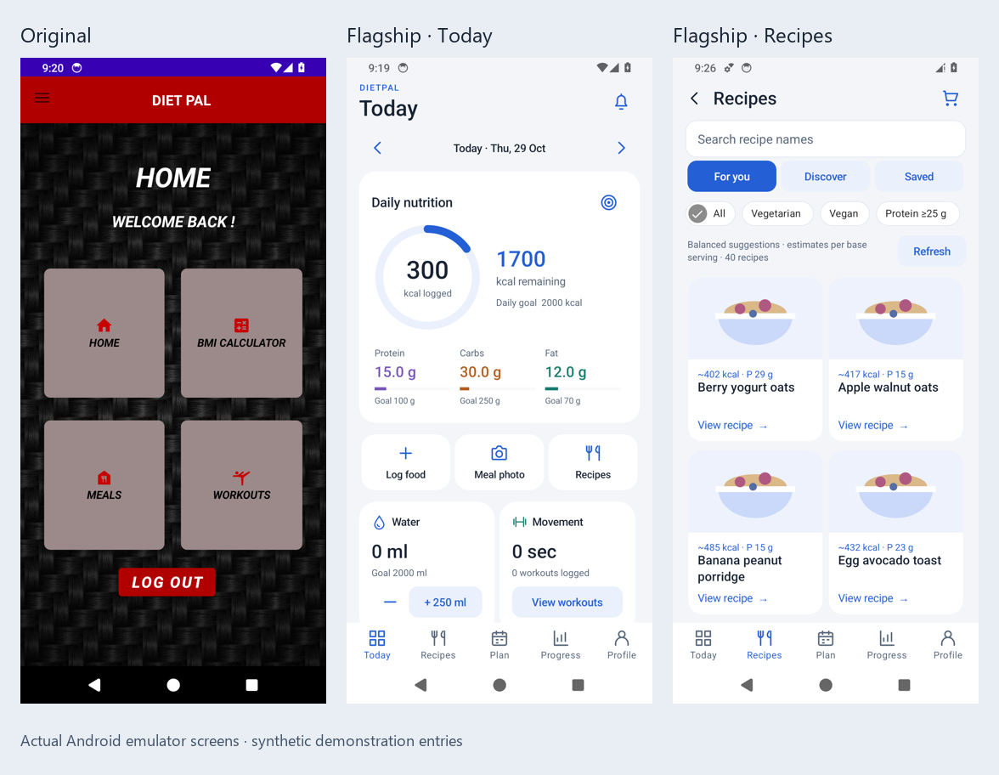

# DietPal

Two independently installable Android editions: the repaired undergraduate app and a new nutrition, meal-planning and movement experience.

| Edition | Explore | Application ID |
| --- | --- | --- |
| **Original** | [Source and build](original/README.md): coursework interface, local accounts, BMI, animated workouts and restored recipes. | `com.example.dietpal` |
| **Flagship preview** | [Source and build](flagship/README.md): diary, custom macro goals, balanced recipes, dated plans, supplements, water, progress and workout records. | `com.example.dietpal.flagship` |
| **Historical source** | [Frozen coursework source](https://github.com/ahmad-527/dietpal-android/tree/coursework-source): selected source bytes preserved, with the embedded credential redacted. | Archival; run the repaired Original edition. |

[Download both review APKs](https://github.com/ahmad-527/dietpal-android/releases/tag/two-edition-preview-20261029) · [Validation and limits](docs/VALIDATION.md) · [Changes and provenance](docs/PORTFOLIO_CHANGES.md)

Actual emulator screens with synthetic demonstration entries.

## Flagship experience

- Portion-aware calorie and macro diary, editable food/label entry, recent foods and packaged-food name/barcode lookup. Missing nutrition remains unknown.
- Exact point, ranged, minimum or maximum targets, including `100-150` g carbohydrate and `>2000` kcal. Goals are dated; changing next week preserves earlier records.
- Forty gram-specified recipes with ingredient-based USDA estimates. Mixed, vegetarian and vegan planning; one to six eating occasions; food/allergen exclusions, variations and swaps.
- Week, calendar-month and calendar-year previews before saving. Target gaps remain visible. Point goals have a disclosed 10% planning tolerance; explicit ranges and limits are strict.
- Optional label-defined supplements, using the user's chosen serving and quantity, counted toward **all** calories and macros. No automatic brand or dose prescription.
- Saved recipes, portion-scaled ingredient checklists, water, weight trends, workout records, animated exercise timers and opt-in local reminders.
- Optional on-device meal-photo estimates with explicit review/editing. The free model is downloaded separately; photos are not uploaded. Hardware and accuracy limits are documented in the build and validation guides.
- No account required. Records stay in the app; JSON export and confirmed deletion are available.

The flagship is a **development preview**, not a clinical nutrition product or a claim of feature parity with established health apps. Macro matching does not establish complete nutrient adequacy. Recipe/food lookup uses online providers; the bundled balanced collection and manual diary work offline.

## Evidence and design

[Interface design](docs/INTERFACE_DESIGN.md) records the Samsung, Huawei and Apple reference patterns. [Nutrition and planning](docs/NUTRITION_AND_PLANNING.md) explains calculations, constraints and research limits. The [100-record screening register](docs/research/SCREENING.md) is title/abstract screening, **not** 100 full-text appraisals or proof the app improves health.

[Third-party notices](docs/THIRD_PARTY_NOTICES.md) cover libraries, food data and service terms. TheMealDB's public educational endpoint is used for this portfolio; app-store distribution requires separate provider arrangements. Physical-phone performance, prospective nutrition accuracy and app-store readiness are not established by emulator tests.

The original coursework was developed at **Majan University College** for **Mobile Application Development, 2023–24**. The later repairs and flagship development are documented separately. The initial portfolio preparation remains at [portfolio-v1](https://github.com/ahmad-527/dietpal-android/tree/portfolio-v1); its earlier validation does not describe the current editions. Private academic records, API credentials, SDK paths, signing keys and model weights are excluded. No repository-wide source licence has been selected.
